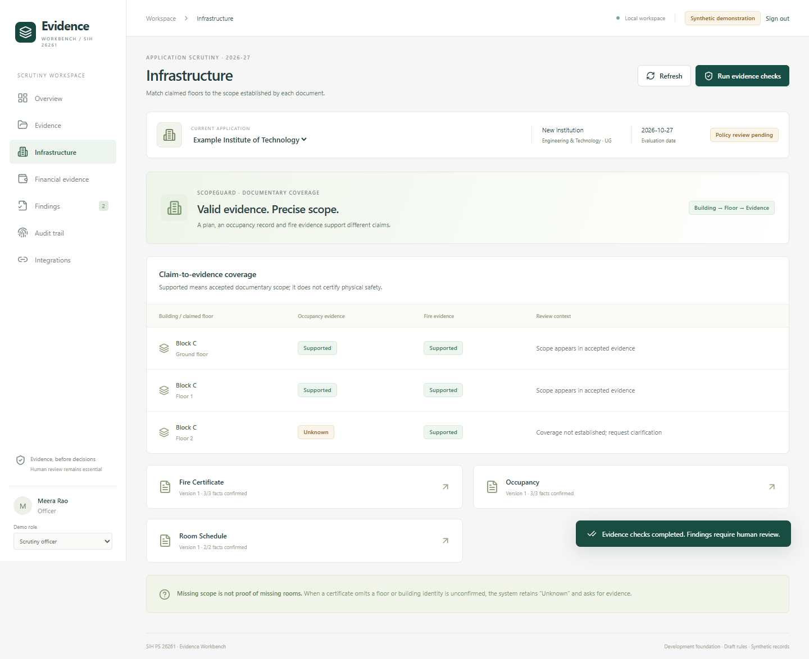

# SIH 26261 · Evidence Workbench

A working development foundation for AICTE application scrutiny. ScopeGuard maps claimed floors to documentary scope; Hestia reconciles exact financial instruments across submitted evidence. Every observation remains human-reviewed and links to its evidence.

**Status: local prototype milestone 0.2, not a production release.** The seeded demonstration is synthetic. A separately stored public-document development corpus tests real layouts; it is not an independent accuracy benchmark. Rules remain draft data-consistency checks, not an approved APH interpretation. No live AICTE/bank/issuer connection or automated institutional approval/rejection.

New local capabilities include CPU OCR, derived-page previews, source-linked manual transcription, layout review hints, SQLite migrations, offline PDF signature checks, QR inspection, frozen PDF reports, password sign-in and an honest connection-status screen. [PaddleOCR setup](docs/PADDLE_OCR.md) uses a separate worker environment; [real-document results](docs/REAL_DOCUMENT_EVALUATION.md) record the extraction gaps.



## Run locally

Requirements: Python 3.13, Node.js 22 or later. The default development store is SQLite and private local files; Docker is optional.

Windows PowerShell, from this directory:

```powershell
python -m venv .venv
.\.venv\Scripts\python.exe -m pip install -r requirements.lock
cd web
npm.cmd ci
npm.cmd run build
cd ..
.\.venv\Scripts\python.exe -m uvicorn app.main:app --host 127.0.0.1 --port 8765
```

Open <http://127.0.0.1:8765>. Choose scrutiny officer, applicant or read-only auditor. On first startup five synthetic PDFs are created and queued through the actual extraction path. Wait briefly for processing. Use only **one API process** for this development profile.

For frontend development, run the API as above, then `npm.cmd run dev` in `web/` and open <http://127.0.0.1:5173>. Production assets and the API share the same origin at port 8765.

macOS/Linux equivalents: use `python3`, `.venv/bin/python`, and `npm`. `requirements.lock` records the tested environment; verify wheels and tests on your operating system.

## Working demonstration

1. Sign in as **Scrutiny officer**. Open **Evidence** and inspect each original PDF.
2. Confirm the displayed facts in each of the five documents. Individual Review/Edit actions append fact revisions and preserve raw text.
3. Run evidence checks. In **Infrastructure**, ground/first-floor occupancy is supported; second-floor occupancy remains unknown. Fire evidence has its own scope.
4. Open **Financial evidence**. FDR `007781` joins only by exact ID, holder and bank. A ₹2 crore unrestricted DPR claim conflicts with ₹1.8 crore lien evidence; unrestricted residual remains unknown.
5. In **Findings**, confirm one observation with a reason. Export includes only current reviewer-confirmed observations and is labelled a synthetic draft-policy demonstration report.
6. Switch to applicant, submit replacement evidence. The old original is retained, current findings become stale/pending and exports are blocked until re-evaluation.
7. Create an **EoA** application as applicant to see a different checklist. Auditor can inspect but cannot change facts/findings or export a new report.

Do not treat a manual source observation as a live API response. Mock/manual modes remain distinct in the UI, audit history and evaluation manifest.

## Implemented

- React + TypeScript workbench with responsive evidence viewer and highlighted source regions.
- Application-scoped access, explicit officer/auditor assignments, opaque server-side development sessions and logout revocation.
- EoA/new-institution context checklists; unsupported categories rejected.
- Bounded PDF intake, detected PDF header, SHA-256, immutable version records and idempotent submission.
- Durable database jobs, startup recovery, bounded parser subprocess and quarantine on failure.
- Native extraction of a deliberately narrow **labelled key/value** format, with page/box provenance; ambiguous keys abstain.
- Append-only accepted-field revisions and optimistic concurrency checks.
- Pure deterministic scope/finance/date/missing-document rules, reproducible complete-input manifests and separate reviewer states.
- Stale-evidence detection, confirmed-only immutable JSON report snapshots and transaction-linked hash-chained audit events.

## Extraction envelope

This milestone does not claim general AI extraction or trained classification. Applicants select the document type; page-level keyword suggestions remain heuristic. Native text and CPU OCR feed conservative labelled-field and unique same-row associations, with source boxes. Scans can use RapidOCR or the explicitly configured PaddleOCR worker. Ambiguous dates, multiple critical candidates, unsupported layouts and uncertain scope require human review. Inline floor mentions are review hints, not certificate coverage. Limit: 10 MB, 30 pages, bounded PDF structure/page dimensions, 300-second document processing deadline. PaddleOCR has a nested 180-second page-worker deadline, so long scans can time out. See [evaluation notes](docs/REAL_DOCUMENT_EVALUATION.md) before citing any accuracy number.

Active PDF actions/attachments are rejected. Optional Windows Defender scanning runs before parsing when configured, quarantining detections or inconclusive results. Structural checks alone are not antivirus. Full OS-level parser/network isolation and a mandatory production scanner remain open release gates. The local prototype has not passed production security acceptance.

## Verify

```powershell
.\.venv\Scripts\python.exe -m pytest tests -q
cd web
npm.cmd run build
npx playwright install chromium
cd ..
node scripts/browser-smoke.cjs
.\.venv\Scripts\python.exe scripts/gate.py --gate foundation
```

Browser tests require the app running and a fresh synthetic seed state, because the journey confirms facts and creates an application. To use installed Edge, set `AICTE_BROWSER_PATH` to its executable before running the browser check. Tests isolate their own database under ignored `.data/test-runs/`. Do not point tests at a shared database.

The foundation gate reruns the tests and web build and records source fingerprints in `reports/foundation-gate.json`; it exits nonzero on failure. `--gate production` writes a blocked report and exits nonzero until production requirements exist. Passing development tests does **not** pass G0–G6 or establish extraction accuracy on real documents. See [delivery status](docs/DELIVERY_STATUS.md) and [security boundaries](SECURITY.md).

## Storage and configuration

- `.data/` contains the ignored local database, private originals and test stores. It is never served as static content.
- `AICTE_DATA_DIR` selects a development data directory. `AICTE_DATABASE_URL` can select PostgreSQL through `postgresql+psycopg://...`; PostgreSQL behavior/RLS is **not yet validated**.
- Every mutation uses application-level access checks; SQLite has no PostgreSQL RLS. API requests cannot select a tenant by supplying an arbitrary tenant field.
- `APP_ENV` defaults to `development`. Any other value refuses startup until production gates are implemented.
- Local persona sign-in is deliberately available only in development, with loopback-host/client checks. It is not production SSO. Never expose this server through a public tunnel.
- Database schema bootstrapping uses SQLAlchemy `create_all`; versioned migration upgrades and production support are next work, not already complete.

## Repository ownership

Team repository: <https://github.com/talluri-mahima/SIHps2>. No third-party implementation was copied. Changes are authored/committed as the user's verified `prajeetjoshua-hub` identity, without Codex co-author attribution. The local development folder name may differ from the repository name.
