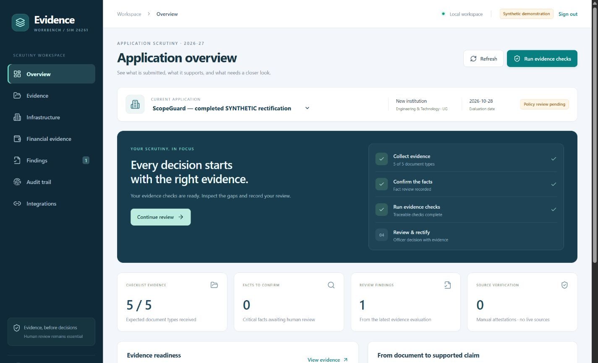

# SIH 26261 | Evidence Workbench

**AI-Powered Application Validation, Document Authentication and Regulatory Compliance Verification**

**Consolidated project history, current scope, test evidence and teammate setup guide**
Current build: **local submission prototype 0.3**, developed on 27–28 October 2026.

> For the teammates preparing the PPT and demo video: this README explains the problem, research-driven changes in direction, each prototype stage, actual test results, current limitations and how to reproduce the demonstration. Planned features and implemented features are deliberately distinguished.



## 1. Problem statement and the pain point

| Item | Context |
|---|---|
| SIH problem statement | **26261** |
| Title | **AI-Powered Application Validation, Document Authentication and Regulatory Compliance Verification** |
| Regulatory setting | All India Council for Technical Education (AICTE), Ministry of Education |
| Intended users | Institutional applicants, scrutiny officers/reviewers and auditors |
| Intended eventual integration | Decision support associated with the AICTE approval portal |
| Implemented now | Standalone local prototype; not deployed inside or connected to the AICTE portal |

The statement supplied to the team concerns preliminary scrutiny of technical-institution applications, including Extension of Approval (EoA) and other approval-related changes. Supporting documents and institutional records must be considered under the applicable Approval Process Handbook, regulations and instructions. Missing or expired documents, inconsistent information, suspected alterations and difficulty obtaining original-issuer confirmation can increase scrutiny effort. This summarizes the supplied statement; it is not a new measurement of AICTE backlog or processing time.

Our precise pain point became:

**An officer needs to establish whether the correct, applicable evidence supports a particular claim, and retain exactly what was verified, what remains unknown and why.**

Reading text is only a first step. A genuine certificate may cover the wrong floor. A deposit may exist but be subject to a lien. A signature can be cryptographically valid without an established trust chain. An issuer can be unavailable. These distinctions must remain visible in the finding and human review.

### Why AICTE material, rather than a media article, is the policy basis

The primary policy author is AICTE. We cite an [AICTE-authored Approval Process Handbook 2024–25 to 2026–27, government-hosted copy](https://cdnbbsr.s3waas.gov.in/s35938b4d054136e5d59ada6ec9c295d7a/uploads/2025/03/2025031399.pdf). Sections 1.8 and 6.17 provide scrutiny/authenticity/rectification and building/occupancy/fire-evidence context; annexures distinguish document purposes and application contexts. This is a government mirror, not an AICTE API or endorsement of our implementation. The [AICTE-hosted URL](https://www.aicte.gov.in/sites/default/files/APH%20Final.pdf) was also considered, but availability was inconsistent during research.

Applicable amendments and policy-owner review remain necessary before operational use. We do not turn policy context into invented backlog statistics, universal floor requirements or unreviewed financial thresholds. Media can provide background, but is not our primary proof of an AICTE requirement.

## 2. Research inputs and how our thinking changed

### Documents and references used

- The supplied SIH26261 statement and the earlier **AICTE Validation Platform** discussion.
- `SIH26261_IMPLEMENTATION_BLUEPRINT.md`: an implementation proposal, **not** the third-party repository's README or proof of implementation.
- `SIH26261_2023_2025_WINNER_EVOLUTION_RESEARCH.pdf`, dated 27 October 2026: the team's research into related statements, predecessor projects and the verification gap.
- The Hestia and ScopeGuard research referenced by those documents.
- Read-only review of public repositories, including [theparthgupta/aicte_doc_verification](https://github.com/theparthgupta/aicte_doc_verification).
- AICTE handbook material and institution-published PDFs.

The original research files were supplied separately and are not required to run the repository. Their build-relevant conclusions are consolidated below. A planning document describes the target; code and recorded tests establish the implemented subset. No third-party repository was altered.

### Changes in opinion and implementation decisions

| Earlier question or assumption | What changed our view | Decision |
|---|---|---|
| Would a portal, OCR and a compliance score be enough? | Existing projects cover much of the generic portal/OCR baseline. A score alone cannot show supporting evidence. | Center the product on evidence-linked scrutiny, not an unexplained overall score. |
| Does an existing repository mean the later PS is already solved? | Public code proves a particular implementation; README claims and later PS requirements must be checked separately. | Acknowledge predecessors and demonstrate a specific engineering delta. No first-ever claim. |
| Was one unchanged project winning repeatedly in 2023–2025? | The supplied report traced different teams and problem IDs with changing emphasis. | Treat it as a related problem lineage, not a verified repeated win by one unchanged project. |
| Should Hestia and ScopeGuard be separate products? | Both require documents, source coordinates, versions, rules, review and audit infrastructure. | One platform; infrastructure primary, financial reconciliation secondary. |
| Is authenticity enough? | A genuine document can still be inapplicable to the claim. | Separate signature integrity, issuer/source state, document purpose and coverage. |
| Can a replacement immediately resolve a finding? | Applicant submission does not establish independent verification. | Require relevant reviewed evidence, source observation, a newer evaluation and explicit resolution. |
| Can we immediately train a curated model? | We had no authorized, independently labelled institutional dataset. | Use pretrained OCR, conservative extraction, human correction and measured abstention. No custom-trained AICTE-model claim. |
| Will replacing OCR fix extraction? | All four initial real PDFs contained some text, yet the original field parser extracted nothing useful. | Improve document interpretation and source review alongside OCR. |
| Is the initial UI presentable? | Testing showed tiny text, weak hierarchy, poor page browsing and mobile issues. | Redesign the workspace and verify desktop/mobile states. |

### Historical lineage described in the supplied research

This table summarizes that report, not a fresh certification of every historical winner claim or private finale capability.

| Related statement | Reported focus / team | Our takeaway |
|---|---|---|
| 2023 / SIH1458 | Stakeholder assistance and handbook comprehension; report identifies Swasthya Sahayak, AKGEC | Handbook assistance is useful but not our central differentiator. |
| 2024 / SIH1729 | End-to-end approval workflow; report identifies Kal Hona Code, KL University | Roles, uploads, dashboards and workflow are baseline product capabilities. |
| 2025 / SIH25253 | Historical institutional data/performance analysis; report identifies Code for Change, Jagannath University NCR | Do not invent a winner's metrics or copy an unexplained approval score. |
| 2026 / SIH26261 | Application validation, authentication and regulatory verification | Make each finding reproducible from evidence, rule versions, source states and review. |

References retained in the report include the [AKGEC achievement page](https://www.akgec.ac.in/achievements/student-awards-technical/), [2023 repository](https://github.com/KushwahaPraveen1/AICTE-SIH1458), [2024 repository](https://github.com/gowtham-2oo5/sih-24-1729), [KL CIIE account](https://www.linkedin.com/pulse/kl-ciie-students-excel-smart-india-hackathon-kluniversity-zvzbc) and [Jagannath University account](https://www.jagannathuniversityncr.ac.in/events/09th-Dec). Institutional reports, self-reports, code and measured behavior carry different evidence. Missing public code does not prove a private winning build lacked a feature. Recheck primary results before making competitor claims in the PPT.

## 3. The solution and current project scope

**Evidence Workbench = application context + source-linked facts + documentary reconciliation + controlled human review.**

### ScopeGuard — primary demonstration

Compare claimed building/floor use with accepted occupancy and fire-document scope. In the synthetic starting case the room schedule claims G, 1 and 2, while occupancy establishes G and 1. Floor 2 remains **scope not established**, not “room absent,” “building unsafe,” or “institution rejected.” Occupancy and fire evidence do not substitute for each other.

### Hestia — secondary demonstration

Join financial evidence by exact normalized instrument number, holder and bank. The synthetic fixture has an INR 2 crore unrestricted funding claim and INR 1.8 crore under lien. The prototype flags the documentary inconsistency and keeps current unrestricted availability **unknown**. Principal minus lien is not certified available funding.

### What is implemented now

| Area | Working capability | Boundary |
|---|---|---|
| Applications | New-institution and EoA draft checklists | Not every AICTE category; category is user-selected |
| Access | Applicant/officer/auditor roles, scoped assignments, passwords and server sessions | Local demo roles are not production SSO |
| Intake/storage | PDF/header/size checks, SHA-256, private originals, immutable versions and idempotency | 10 MB / 30-page limit |
| Processing | Native text, stored previews, RapidOCR and separate PaddleOCR CPU provider | Conservative English extraction; difficult layouts/handwriting can fail |
| Evidence | Page/box provenance, unconfirmed candidates, correction revisions and manual facts | No automatic critical-fact acceptance |
| Understanding | Label/value association, selected narrative/floor patterns, EoA metadata, page suggestions and warnings | Heuristic purpose detection is not a validated classifier |
| OCR comparison | Re-read a selected stored page with local OCR | Alternative transcription does not overwrite accepted facts |
| Checks | Draft scope, identity/lien, completeness, expiry and payment-receipt-purpose checks | No approved numeric regulatory thresholds or institutional decisions |
| Verification | Defender adapter, offline signature integrity/trust checks, QR decoding without following links | No live AICTE/bank/issuer/DigiLocker connection; offline revocation unresolved |
| Rectification | In-app request, response, replacement, newer evaluation and evidence-linked resolution/history | No email/SMS integration; replacement alone cannot resolve |
| Reports | Frozen JSON/PDF with current confirmed observations and reviewed rectification history | Demonstration reports, not official deficiency notices |
| Operations | SQLite/Alembic migrations, durable jobs, launcher/restart, backup and packaging | One local API process; production deployment acceptance remains open |

No paid external API is required for the local prototype. The submission environment was deliberately a laptop with internet and free local services. Paid APIs are a future option, not an integration already completed.

## 4. Development history

### Stage A — research and scope freeze

The original discussion connected this PS to the team's regulated-evidence experience with Cassandre, while keeping post-sanction credit monitoring and education regulation distinct. The blueprint was broader than the submission implementation. We narrowed to one complete, inspectable scrutiny journey: infrastructure first, finance second, draft deterministic checks and retained human authority.

### Stage B — prototype level 1 / milestone 0.1

Built the React/TypeScript workbench, FastAPI backend, SQLite/private files, scoped roles/applications, synthetic PDF fixtures, native labelled-field extraction/source boxes, review, scope/finance checks, versioning, stale-result blocking, confirmed-only JSON exports and hash-linked audit.

This proved a real processing/review workflow, not precomputed screen results. Its deliberately narrow synthetic format did not prove general document understanding, issuer authenticity or real-data accuracy.

Commit: [`6356964`](https://github.com/talluri-mahima/SIHps2/commit/6356964eea8062b0fa6b926cf62da4604605c522). Recorded gate: **48 tests passed**, with **10 recorded browser checks** for the initial journey.

### Stage C — real documents exposed the gap

No authorized anonymized application samples were initially available. We collected institution-published documents locally and recorded source URLs/hashes. The first set contained **39 pages**: TSM occupancy (4), TSM fire licence (1), MES disclosure (28), BIT Sindri EoA (6).

**The initial parser produced zero structured critical-field candidates from all four PDFs.** Existing text layers did not make their narrative/table layouts compatible with the synthetic parser. It requested manual extraction rather than silently supporting claims. This changed our plan: installing OCR alone was insufficient.

Public availability does not independently authenticate the issuer or establish training/redistribution permission. Original PDFs remain local and ignored by Git.

### Stage D — OCR and verification / milestone 0.2

Added CPU OCR, derived-page processing, versioned migrations, manual transcription, password login, verification observations, offline signatures, QR inspection, readiness status, PDF exports and backup tooling.

RapidOCR was the first working scan baseline. We then integrated **PaddleOCR 3.7.0 / PaddlePaddle 3.3.1** in an isolated environment with local detection and English-recognition models. This avoids conflicting API/OCR dependencies. Initial real-page attempts hit a 90-second limit; direct recognition, worker reuse and bounded allowances were then tested. oneDNN acceleration raised a Windows PIR conversion error, so it is disabled in the tested configuration. We retained measured latency rather than claiming PaddleOCR was faster.

Commit: [`dab101f`](https://github.com/talluri-mahima/SIHps2/commit/dab101f3ba8782cdef06f35c41e1dee2ffa70aba). Its committed gate records **77 passing tests**. Intermediate progress messages had different counts; the committed report is the evidence.

The synthetic document evaluation recorded **21/21 expected fields** across eight development cases, including three scans and abstention cases. An actual password → upload → Defender → PaddleOCR → preview → signature-check rehearsal passed on an image-only synthetic PDF. Its three expected fields remained unconfirmed.

### Stage E — interpretation, rectification and UI / milestone 0.3

Added selected building/floor narrative patterns, EoA metadata, repeated-table abstention and scanned-text-layer warnings. A selected-page OCR comparison now retains an alternative transcription without silently changing accepted facts.

Payment-receipt pages are prevented from supporting building/fire-certificate scope, even if their fields were confirmed. One attempted live institutional download returned HTML and was rejected, so it was not counted as a measured real PDF. A cached web representation motivated a synthetic negative control; this is not an allegation about an institution.

Completed the full clarification journey. Resolution needs a newer current evaluation, relevant current evidence, confirmed facts, explicit source observation and a reason. Unrelated evidence, stale results, missing expiry values and unsupported direct resolution are rejected. Rule-pack changes also invalidate current-use evaluations. Old originals and frozen exports survive.

Redesigned the login, navigation, overview, evidence workspace and review history. Added free page browsing, including pages without extracted facts, and prevented wrong-page highlights. Desktop/mobile inspection is separately recorded.

Commit: [`637f1df`](https://github.com/talluri-mahima/SIHps2/commit/637f1dfc47274ce535b1ff425a948093e48c21f0). Final recorded gate: **88 passing tests**, zero failures/errors/skips, plus frontend build. [GitHub CI passed](https://github.com/talluri-mahima/SIHps2/actions/runs/40629938611).

Prepared two separate cases: unconfirmed public-document review and a completed **synthetic** rectification rehearsal. Real institution facts were not auto-confirmed. A fifth public PDF added four pages, bringing collected material to **43 pages**.

### Stage F — teammate handover and main branch

This consolidated README updates the repository scope and brings the working prototype history onto `main`. Commits use the verified **prajeetjoshua-hub / P Prajeet Joshua** identity, without Codex co-author attribution. This documentation release is not a new model-accuracy experiment or a production approval.

## 5. What happens behind the interface

```text
Scoped login and application context
 -> private PDF upload, hash, version and job
 -> configured malware scan and bounded structure checks
 -> native text / local OCR, stored previews and coordinates
 -> proposed fields, purpose hints and warnings
 -> explicit reviewer confirmation/correction, preserving earlier values
 -> deterministic checks over frozen evidence/rule manifests
 -> evidence-linked findings with unknown/source states
 -> clarification, response, replacement and newer evaluation
 -> reviewed resolution and frozen JSON/PDF report
```

**Stack:** React, TypeScript, Vite, Lucide; FastAPI, SQLAlchemy, Alembic, SQLite; PyMuPDF; RapidOCR/ONNX; a separate PaddleOCR CPU worker; pyHanko offline signature checks; private local file storage.

The database retains applications, assignments, document/field versions, jobs/results, verification observations, evaluations, findings, exports and audit events. Evaluation manifests pin document versions, accepted fields, verification observations and rule-pack identity.

An LLM does **not** decide compliance. OCR recognizes text; conservative extraction proposes facts; deterministic code checks documentary relationships; the reviewer controls acceptance and findings. MANUAL and MOCK source observations, signature integrity and documentary scope are separate. A mock response never becomes a real issuer response. The audit hash chain checks continuity; it is not tamper-proof against a privileged administrator.

## 6. Testing history and measured results

| Evidence | Recorded result | Meaning / limitation |
|---|---|---|
| Foundation 0.1 | 48 passing tests | Engineering behavior, not OCR accuracy |
| OCR milestone 0.2 | 77 passing tests | Expanded behavior, not representative document accuracy |
| Current foundation gate | **88 passed**, zero failures/errors/skips; build passed | Source-fingerprinted software checks |
| Earlier browser smoke | 10 checks passed | Inspect its timestamp; redesign review is separate |
| Synthetic document check | **21/21 expected fields**, zero wrong/unexpected/missed | Eight development fixtures; not held-out real data |
| First real-document baseline | Zero structured candidates from four PDFs | Exposed the layout gap |
| Current provisional real-field check | **11 correct / 12 selected values; 1 wrong; 0 missed; 10/12 citation-region matches** | Assistant visual labels; other candidate keys unscored; no generalized accuracy claim |
| Institution-separated EoA | 4/4 selected values | Parser hashes frozen before label inspection; not independently human-validated |
| Actual scanned-upload rehearsal | Passed; three expected synthetic fields, all unconfirmed | Real local login/upload/Defender/PaddleOCR/preview/signature path |
| Actual public-page OCR comparison | Expected spelling recovered; accepted facts unchanged/unconfirmed | One page/phrase, not overall accuracy |
| Rectification checks | Full lifecycle and negative cases passed | Role, stale-export, irrelevant-evidence and unsupported-resolution guards |
| UI review | Desktop and 390×844 mobile views inspected; no measured overflow on tested mobile views | Not full accessibility certification or independent usability research |

### Measured OCR rehearsal times

| Real page | RapidOCR | PaddleOCR |
|---|---:|---:|
| Fire licence | 7.887 s | 107.001 s |
| Dense occupancy table | 18.874 s | 121.006 s |

The later application-level fire-page comparison recorded **28.559 s**; the synthetic upload rehearsal recorded **16.493 s**. Different startup/workload conditions mean these are not a speed guarantee. Recognized-region counts do not compare accuracy. Limits include a 300-second document job, 180-second nested Paddle page wait and 210-second page-comparison route. Difficult scans can time out.

### Evidence files

- [Current gate and source hashes](reports/foundation-gate.json), [earlier browser smoke](reports/browser-smoke.json), [current UI review](reports/ui-review.json).
- [Synthetic document results](reports/development-document-check.json).
- [Public-source manifest](reports/public-document-sources.json) and [layout coverage](reports/public-layout-coverage.json).
- [Provisional labels](fixtures/real-document-labels.json), [real-field results](reports/real-document-check.json), [parser freeze](reports/extractor-freeze.json), [teammate review sheet](fixtures/label-review-template.csv).
- [Provider timing rehearsal](reports/ocr-provider-rehearsal.json), [actual scanned-upload rehearsal](reports/paddle-upload-rehearsal.json), [actual public-page OCR comparison](reports/public-ocr-comparison.json).

The wrong real-field value is an institution name misspelled in embedded OCR text. The prototype flags the text layer and offers an alternative transcription. An officer must inspect the original and explicitly correct it. We retain the error in the test report rather than changing labels to manufacture perfection.

## 7. Download and set up on your own system

### A. Windows: working baseline

Tested environment: **Windows, Python 3.13.7, Node.js 22**. Install Git, Python 3.13 and Node.js 22 if missing. A GPU, Docker and paid API keys are unnecessary. Use PowerShell, not a Python prompt.

```powershell
git clone --branch main https://github.com/talluri-mahima/SIHps2.git
cd SIHps2
py -3.13 -m venv .venv
.\.venv\Scripts\python.exe -m pip install -r requirements.lock
if (-not (Test-Path .env)) { Copy-Item .env.example .env }
cd web
npm.cmd ci
npm.cmd run build
cd ..
.\.venv\Scripts\python.exe scripts/local_accounts.py --generate
.\scripts\start-prototype.ps1
```

If `py` is unavailable but `python --version` reports 3.13, use `python -m venv .venv`. Open **http://127.0.0.1:8765** on the same laptop. Do not open the HTML file directly. Allow the five seeded synthetic PDFs to process.

The example environment selects **RapidOCR**, a working free baseline. Cloning alone does **not** enable PaddleOCR: complete part B. Local passwords are generated into ignored `.data/local-access.txt`; do not commit/share that file. Labelled demo role buttons remain available while `AICTE_DEMO_LOGIN=true`.

If PowerShell blocks scripts, run the foreground server instead:

```powershell
.\.venv\Scripts\python.exe -m uvicorn app.main:app --host 127.0.0.1 --port 8765
```

Keep that terminal open. The background launcher must be run after a laptop restart. After pulling backend changes, use `scripts/restart-prototype.ps1`; it targets this checkout's matching local server. Use one API process. This is loopback-only, not a public team-hosted URL.

### B. Enable the tested PaddleOCR provider

Use a separate environment to avoid dependency conflicts:

```powershell
py -3.13 -m venv .venv-paddle
.\.venv-paddle\Scripts\python.exe -m pip install -r requirements-paddle.lock
.\.venv-paddle\Scripts\python.exe scripts/paddle_worker.py --provision
```

Provisioning downloads the named official detection/English-recognition bundles into local cache and ignored `.data/paddle-models/`. Internet is needed for installation/provisioning; application documents are not sent to a cloud OCR service.

Edit `.env`, then restart:

```dotenv
APP_ENV=development
AICTE_OCR_ENABLED=true
AICTE_OCR_PROVIDER=paddleocr
AICTE_OCR_FORCE=false
AICTE_DEMO_LOGIN=true
```

Set `AICTE_PADDLE_PYTHON` to an absolute isolated-interpreter path if needed. Use the page-comparison action for weak text layers rather than globally forcing OCR for the presentation. Regional-language accuracy is not established.

On a supported Windows installation, optional `AICTE_MALWARE_SCANNER=defender` enables the installed provider. Verify an actual scan before claiming it is connected. This setting does not apply to machines without Defender.

### C. Recreate the prepared demo cases

**The developer's database, passwords, downloaded originals and prepared applications are not shipped in Git.** A fresh clone contains synthetic seed fixtures. With accounts generated and the server running:

```powershell
.\.venv\Scripts\python.exe scripts/collect_public_documents.py --new-only
.\.venv\Scripts\python.exe scripts/prepare_submission_demo.py
```

This adds:

- **Public TSM documents — review only, issuer unverified:** public originals, unconfirmed fields, no invented real institutional claim.
- **ScopeGuard — completed SYNTHETIC rectification:** recorded clarification/replacement/resolution with explicit MOCK mode and synthetic audit reasons.

After enabling PaddleOCR, optionally run:

```powershell
.\.venv\Scripts\python.exe -m scripts.rehearse_public_ocr
```

Sources can change or fail; the manifest records state and hashes. Do not replace an unavailable original with a fabricated real certificate. The synthetic baseline remains usable.

### D. Run checks and package the prototype

```powershell
.\.venv\Scripts\python.exe -m pytest tests -q
.\.venv\Scripts\python.exe scripts/gate.py --gate foundation
.\.venv\Scripts\python.exe scripts/real_document_check.py
.\.venv\Scripts\python.exe scripts/backup.py
.\.venv\Scripts\python.exe scripts/package_submission.py
```

The real-document check requires the downloaded hash-matching PDFs. Packaging creates `.data/submission/SIH26261-prototype-0.3.zip` with file hashes, source, built UI, tests and reports. It excludes private runtime data, passwords, `.env`, environments and original PDFs. Provision OCR models separately on another machine. Do not upload the entire `.data` folder.

`scripts/document_check.py` generates the synthetic extraction fixtures; use the default RapidOCR profile to reproduce its recorded baseline. Its scanned fixture is required by `scripts/paddle_upload_rehearsal.py`. Browser smoke needs a running app and Playwright Chromium (`cd web; npx playwright install chromium`) or `AICTE_BROWSER_PATH` pointing to Chrome/Edge. It mutates synthetic records, so use a disposable local demo store.

For frontend development, run the API plus `npm.cmd run dev` in `web` and open http://127.0.0.1:5173. On macOS/Linux use `python3.13`, `.venv/bin/python` and `npm`; Windows launchers/Defender do not apply. Core CI runs on Linux, but the full Paddle/Defender laptop demonstration was tested on Windows. Verify wheels and set the correct Paddle interpreter path before claiming identical behavior elsewhere.

### E. Common setup problems

| Problem | First action |
|---|---|
| Page does not open | Start the server, use HTTP port 8765 on the same laptop, inspect `.data/server.stderr.log`. |
| No built interface | Run `npm.cmd ci` and `npm.cmd run build` in `web`. |
| Old interface | Ctrl+Shift+R after building; restart after backend changes. |
| Paddle unavailable | Check isolated install, provisioned models, `.env` provider/interpreter and restart. |
| OCR slow | Dense pages can take around two minutes. Wait or show a clearly identified recorded observation. |
| Document quarantined | Inspect scanner/processing state; do not bypass it or claim verification. |
| Extra demo cases absent | Recreate them with part C; the original developer database is excluded. |
| Export blocked | Review facts and run current checks; evidence, source and rule changes can invalidate results. |

## 8. How teammates should test it

1. Choose officer and **Example Institute of Technology**. Inspect originals/highlights, confirm checked facts and run evidence checks.
2. Verify the uncovered second-floor occupancy and the separate financial lien inconsistency. Unknown is not proof of absence or fraud.
3. Open the completed **SYNTHETIC rectification** case. Expand Findings → Clarification & rectification. Inspect request, response, old original, replacement, newer evaluation and reviewed resolution. Export the PDF; MOCK must remain visible.
4. Open the public TSM case. Browse all four occupancy pages. On the fire document compare the embedded spelling with the original/alternative OCR. Facts remain unconfirmed until explicitly reviewed.
5. In a new test application replace a document after evaluation. Check stale/export blocking. Try irrelevant evidence or resolution without source review: it should be rejected.
6. Switch to applicant/auditor. Officer-only mutations must be unavailable/denied. Integrations must show external issuer services as NOT_CONNECTED.

Report failures with case, document, expected/actual result and a screenshot—without passwords/private records. Never present a synthetic document as an issuer original.

## 9. PPT and demo-video handover

### Suggested PPT sequence

1. PS title, user and precise scrutiny pain point.
2. AICTE primary-policy context and source hierarchy.
3. Research evolution: assistance → workflow → historical analytics → evidence verification. Attribute historical reconstruction to the report.
4. Shared architecture; ScopeGuard primary, Hestia secondary.
5. Source PDF → accepted fact → coverage matrix → finding.
6. Clarification and replacement lifecycle with preserved history.
7. Real extraction failure, alternative OCR and the actual test-results table.
8. Limits, remaining authorized integrations and validation plan.

### Five-minute demo video

| Time | Show |
|---|---|
| 0:00–0:40 | Problem, current scope and overview |
| 0:40–1:40 | Starting occupancy PDF, highlight and uncovered floor |
| 1:40–2:50 | Completed synthetic request/response/replacement/resolution and PDF |
| 2:50–4:10 | Public-document pages, text-layer warning and recorded/local OCR comparison |
| 4:10–5:00 | Hestia/unknown residual, integrations, results and limits |

Use a recorded OCR observation if a dense-page run would consume the video window; identify it as recorded. Screenshots are in [reports/screenshots/redesign](reports/screenshots/redesign). A [detailed presenter guide](docs/SUBMISSION_DEMO_GUIDE.md) is also available. No finished PPT or narrated video is claimed to exist; teammates can create them using this handover.

**Safe claims:** actual local OCR; source-linked review; exact documentary reconciliation; immutable versions; retained human control; explicit source uncertainty; 88 recorded engineering tests; a small provisional real-document evaluation.

**Do not claim:** 100%/representative accuracy, proven fraud detection, a custom-trained AICTE model, live AICTE/bank/DigiLocker access, universal APH compliance, production readiness, first-ever novelty or a guaranteed SIH win.

## 10. Remaining work and source links

Before operational use: independent human labels and a larger sealed institutional test set; approved context-specific rule packs/amendments; authorized issuer/API agreements; broader document/language coverage; production identity, database/RLS or equivalent isolation, managed storage/key/retention controls; OS-level parser/network isolation; capacity, recovery, privacy, accessibility and policy acceptance. **SQLite Alembic migrations already exist**; production database validation does not.

For this submission, a teammate should independently check the 12 provisional labels using [the review sheet](fixtures/label-review-template.csv). Do not relabel errors as correct to improve the score.

Primary/current references:

- [AICTE-authored handbook, government copy](https://cdnbbsr.s3waas.gov.in/s35938b4d054136e5d59ada6ec9c295d7a/uploads/2025/03/2025031399.pdf).
- [TSM disclosures](https://tsm.ac.in/mandatory-disclosure), [BIT Sindri EoA](https://www.bitsindri.ac.in/wp-content/uploads/2026/04/Extension-of-Approval-EOA-Report-2026-27.pdf), [BCREC APC EoA](https://bcrecapc.ac.in/public/pdf/2026-27.PDF). Institutional publication is not issuer authentication.
- [Official PaddleOCR repository/licence](https://github.com/PaddlePaddle/PaddleOCR). Local OCR does not require a paid OCR API.
- [Security boundary](SECURITY.md), [delivery status](docs/DELIVERY_STATUS.md), [Paddle setup](docs/PADDLE_OCR.md), and the linked evidence reports.

**Handover principle:** keep proposed scope, implemented behavior, measured results, issuer verification and human review distinct. That distinction is the product's central contribution.
